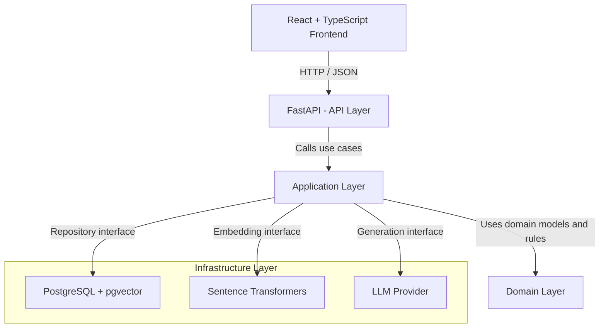

# System Architecture

## 1. Architectural Style

The Unwritten Rules uses a modular monolith with
clean architectural boundaries.

The system begins as one deployable backend application,
with independently organised responsibilities.

Microservices are not introduced unless operational or
scaling requirements justify them.

### High-Level Architecture Diagram

The following diagram illustrates the planned architecture
of The Unwritten Rules.

The arrows to infrastructure represent logical service
interactions, not direct imports of concrete implementations.

Application services depend on interfaces or protocols.
Infrastructure adapters implement those interfaces.

The application's composition root connects the concrete
implementations to the application services.

Domain models remain independent of external services.

## 2. Technology Stack

- Frontend: React and TypeScript
- Backend API: FastAPI
- Domain validation: Pydantic
- Database: PostgreSQL
- Vector search: pgvector
- Embeddings: Sentence Transformers
- Testing: pytest
- Containerisation: Docker
- CI: GitHub Actions

These are architectural technology choices.
Not all components have been implemented yet.

## 3. Backend Layers

### Domain

Contains experience-related models and domain rules.

Responsibilities:
- Experience representation
- Context representation
- Evidence classification
- AI inference representation
- Domain validation

The domain must not depend on FastAPI, PostgreSQL,
embedding frameworks, or external AI services.

### Application

Coordinates system use cases.

Planned responsibilities:
- Submit experiences
- Retrieve experiences
- Moderate submissions
- Perform context-aware search
- Generate grounded explanations

The application layer may depend on domain models
and abstractions of external services.

### Infrastructure

Contains implementations of external integrations.

Planned responsibilities:
- Database access
- Vector storage
- Embedding generation
- LLM integration
- External configuration

Infrastructure implementations may depend on domain
and application interfaces.

### API

Exposes application functionality over HTTP.

Responsibilities:
- Define routes
- Validate request and response formats
- Translate HTTP requests into application operations
- Translate application outcomes into HTTP responses

Business logic should not be implemented directly
inside route handlers.

## 4. Dependency Rules

Allowed dependencies:

- API -> Application
- Application -> Domain
- Infrastructure -> Domain
- Infrastructure -> Application interfaces

Disallowed dependencies:

- Domain -> API
- Domain -> Infrastructure
- Domain -> FastAPI
- Domain -> Database or LLM implementations

The application layer must not import concrete
database or AI provider implementations.

Dependency injection will connect abstractions
to concrete implementations at the application boundary.

## 5. Engineering Principles

### Single Responsibility

Modules and classes should have one coherent responsibility.

### Open/Closed

Extend behaviour through appropriate interfaces
when variation is required, without prematurely
introducing abstraction layers.

### Liskov Substitution

Implementations of shared interfaces must honour
their behavioural contracts.

### Interface Segregation

Use focused interfaces rather than broad interfaces
with unrelated responsibilities.

### Dependency Inversion

High-level application logic depends on abstractions
rather than concrete external services.

## 6. Initial Design Constraints

- Preserve contributor narratives exactly.
- Keep AI-generated analysis separate from contributor data.
- Do not treat missing context as irrelevant.
- Do not publicly retrieve unapproved experiences.
- Keep domain logic independent of infrastructure.
- Prefer simple, testable modules over premature abstractions.

## 7. Architectural Trade-offs

### Modular Monolith vs Microservices

Decision: Modular monolith.

Rationale:
- Lower deployment complexity
- Easier local development
- Simpler testing
- Appropriate for current project scale

Trade-off:
- Components share a deployment lifecycle.

### Flexible Context vs Fixed Schema

Decision: Flexible context dictionary with validated values.

Rationale:
- Social interactions have variable contextual dimensions.
- New dimensions should not require database model redesign.

Trade-off:
- Context naming consistency requires additional
  preprocessing or normalisation.

### Separate AI Analysis

Decision: Store AI analysis separately from contributor data.

Rationale:
- Preserves provenance.
- Supports regeneration with different models.

Trade-off:
- Requires explicit association and reference validation.

## 8. Implementation Status

Currently implemented:
- Domain experience models
- Context and evidence models
- AI inference models
- Domain validation tests

Planned:
- API endpoints
- Application services
- Persistence
- Embedding and retrieval pipeline
- RAG generation
- Frontend
- Containerisation and deployment
