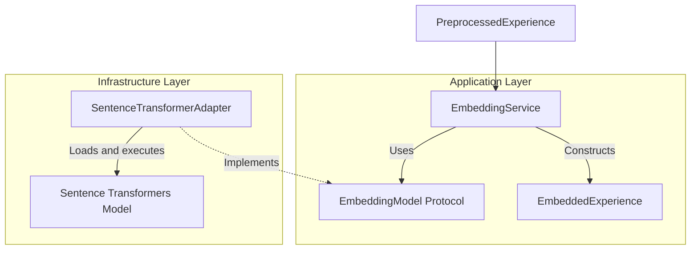
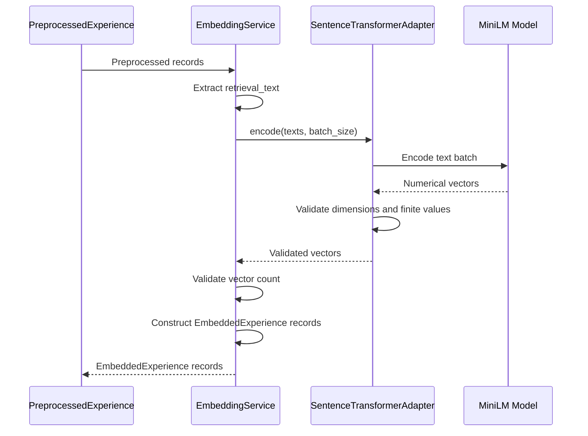
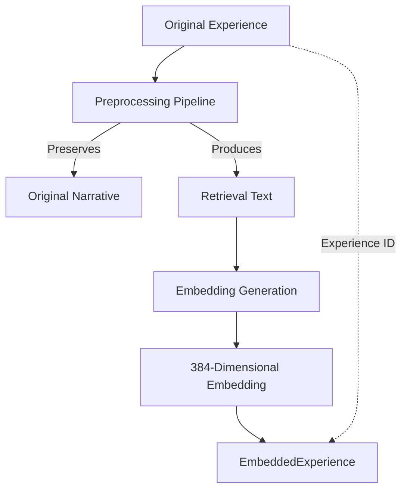

# Embedding Generation

**User Story:** US-008 — Implement Embedding Generation  
**Status:** Implemented; pending final acceptance review

---

## 1. Purpose

The embedding generation component transforms preprocessed social experiences into numerical vector representations for downstream semantic retrieval.

The component is responsible for:

- Generating embeddings from preprocessed retrieval text.
- Supporting batch embedding generation.
- Validating generated vectors.
- Preserving associations between embeddings and their source experiences.
- Supporting replacement of the underlying embedding model.

The component does not perform similarity search, contextual reranking, social expectation identification, or RAG generation.

---

## 2. Architecture

The embedding component follows the Dependency Inversion Principle.

Application logic depends on an embedding model protocol rather than a specific machine-learning framework.

### 2.1 Component Architecture



### 2.2 Component Responsibilities

| Component | Responsibility |
|---|---|
| `EmbeddingConfig` | Defines the embedding model identifier, expected dimensions, and batch size. |
| `EmbeddingModel` | Defines the model-independent embedding interface. |
| `SentenceTransformerAdapter` | Loads a Sentence Transformers model and generates validated vectors. |
| `EmbeddingService` | Coordinates embedding generation for preprocessed experiences. |
| `EmbeddedExperience` | Represents a validated embedding and its associated metadata. |

### 2.3 Dependency Boundaries

The dependency direction is:

```text
Application Service
        |
        v
EmbeddingModel Protocol
        ^
        |
Infrastructure Adapter
        |
        v
Sentence Transformers
```

The application service does not import `SentenceTransformerAdapter` or the Sentence Transformers library.

The infrastructure adapter satisfies the `EmbeddingModel` protocol through structural typing.

Concrete dependencies are supplied when constructing the application service.

---

## 3. Model Configuration

The initial embedding model is:

`sentence-transformers/all-MiniLM-L6-v2`

| Parameter | Value |
|---|---|
| Model | `sentence-transformers/all-MiniLM-L6-v2` |
| Embedding dimensions | 384 |
| Default batch size | 32 |
| Input | `PreprocessedExperience.retrieval_text` |
| Output | `EmbeddedExperience` |
| Embedding implementation | Sentence Transformers |

The model configuration is represented by `EmbeddingConfig`.

The service verifies that the embedding model's reported dimensionality matches the configured dimensionality.

The adapter can be replaced with another implementation of `EmbeddingModel`, provided its dimensions match the configuration.

---

## 4. Embedding Pipeline

### 4.1 Sequence Diagram



### 4.2 Processing Steps

1. The application receives a sequence of `PreprocessedExperience` records.
2. `EmbeddingService` extracts `retrieval_text` from each record.
3. The service validates that retrieval texts are nonblank.
4. The service calls the configured `EmbeddingModel`.
5. The adapter generates embeddings using Sentence Transformers.
6. The adapter validates the generated vectors.
7. The service verifies that the number of vectors matches the number of input records.
8. The service constructs validated `EmbeddedExperience` objects.
9. Each output record retains the corresponding source experience identifier.

The output order matches the input order.

An empty input collection produces an empty result.

---

## 5. Data Flow and Narrative Preservation

The embedding pipeline operates on a derived retrieval representation rather than modifying contributor narratives.



`PreprocessedExperience` contains:

- `experience`: The validated source experience.
- `original_narrative`: The original contributor narrative.
- `retrieval_text`: The derived text used for embedding generation.
- `content_fingerprint`: A preprocessing fingerprint.

The embedding service reads `retrieval_text`.

It does not rewrite or mutate `experience.narrative` or `original_narrative`.

This separation is necessary because retrieval representations may evolve without altering contributor-submitted material.

---

## 6. Validation and Error Handling

### 6.1 Configuration Validation

`EmbeddingConfig` validates that:

- The model name is nonblank.
- The configured dimensions are positive.
- The batch size is positive.

### 6.2 Adapter Validation

`SentenceTransformerAdapter` validates that:

- The model name is nonblank.
- The loaded model reports positive embedding dimensionality.
- The batch size is positive.
- Inputs are provided as a list.
- Every input is a nonblank string.
- The number of generated vectors matches the number of inputs.
- Each generated vector has the model's reported dimensions.
- Every vector component is finite.

### 6.3 Service Validation

`EmbeddingService` validates that:

- Model dimensions match the configured dimensions.
- Retrieval texts are nonblank.
- The number of generated vectors matches the number of records.

Each generated `EmbeddedExperience` additionally validates:

- A nonblank record identifier.
- A nonblank model name.
- Positive dimensionality.
- A nonempty embedding.
- Finite numerical components.
- Agreement between vector length and declared dimensionality.

### 6.4 Failure Behaviour

Invalid inputs or outputs raise exceptions rather than silently producing malformed embeddings.

The service does not implement retries, persistence, or model-download recovery.

These responsibilities should be addressed at their appropriate architectural boundaries when needed.

---

## 7. Testing and Verification

The embedding component has undergone unit testing, real-model smoke testing, and application-level integration testing.

### 7.1 Unit Tests

Test modules:

- `tests/test_embedding_interface.py`
- `tests/test_embedding_service.py`
- `tests/test_sentence_transformer_adapter.py`

Verified behaviours include:

- Protocol compatibility.
- Batch processing.
- Empty-input handling.
- Model replacement.
- Dimension mismatch rejection.
- Incorrect vector-count rejection.
- Non-finite value rejection.
- Invalid batch-size rejection.
- Blank-text rejection.

**Result: 20 tests passed.**

### 7.2 Real-Model Smoke Test

The actual `sentence-transformers/all-MiniLM-L6-v2` model was loaded and used to encode three texts.

Verified:

- Model dimensionality: 384.
- One embedding generated per input.
- All vector components finite.
- Identical texts produced identical embeddings.
- Different texts produced different embeddings.

**Result: Passed.**

### 7.3 Application Integration Test

`EmbeddingService` was connected to the real `SentenceTransformerAdapter`.

Two preprocessed experiences were embedded.

Verified:

- Two output records generated.
- Each embedding contained 384 numerical values.
- Record identifiers matched their source experiences.
- Original narratives remained unchanged.
- All embedding values were finite.

**Result: Passed.**

### 7.4 Automated Versus Manual Testing

The 20 unit tests are implemented using pytest.

The real-model smoke test and application integration test were executed manually.

They are not yet included in the automated test suite.

This separation keeps routine unit testing independent of model downloads and heavyweight model initialization.

---

## 8. Architectural Decisions

### 8.1 Dependency Inversion

**Decision:** Application services depend on `EmbeddingModel`, not directly on Sentence Transformers.

**Rationale:**

- Supports model replacement.
- Enables deterministic unit tests.
- Reduces framework coupling.
- Keeps application logic independent of infrastructure.

### 8.2 Separation of Responsibilities

**Decision:** Model-specific operations belong to the infrastructure adapter.

**Rationale:**

- `SentenceTransformerAdapter` handles model loading and vector generation.
- `EmbeddingService` handles application-level orchestration.
- `EmbeddedExperience` handles output data validation.

This avoids concentrating unrelated responsibilities in one component.

### 8.3 Independent Semantic Baseline

**Decision:** Embedding generation must remain independent of contextual reranking and social expectation reasoning.

**Rationale:**

- Supports reproducible semantic retrieval evaluation.
- Allows future contextual retrieval improvements to be measured against a baseline.
- Avoids coupling embedding generation to later reasoning features.

### 8.4 Model Replaceability

**Decision:** Alternative embedding implementations must satisfy the same protocol.

**Rationale:**

The architecture should support future model experimentation without rewriting application services.

A replacement model may require different embedding dimensions and corresponding downstream vector-index configuration.

### 8.5 Reproducibility

**Decision:** Generated embedding records retain the configured model name and embedding dimensionality.

**Rationale:**

These fields provide basic traceability for downstream retrieval and evaluation.

**Known limitation:** The current records do not include an immutable model revision or preprocessing version.

These may be introduced when reproducibility requirements demand them.

---

## 9. Scope Boundaries

US-008 implements embedding generation only.

It does not implement:

- Vector database persistence.
- Nearest-neighbour similarity search.
- Semantic retrieval ranking.
- Context-aware reranking.
- Contextual compatibility scoring.
- Social expectation recognition.
- Conflicting-expectation detection.
- Evidence-grounded generation.
- Behavioural guidance.

These responsibilities belong to subsequent user stories.

---

## 10. Next Steps

### US-009 — Semantic Retrieval Baseline

The next stage will use generated embeddings to establish a semantic retrieval baseline.

The baseline must remain independently measurable.

Future contextual retrieval methods will be evaluated against this baseline rather than replacing it without comparison.

### US-010 — Retrieval Evaluation

The retrieval pipeline will be evaluated using the existing relevance-labelled dataset.

Metrics will include Recall@K and Mean Reciprocal Rank (MRR), as appropriate to the evaluation design.

---

## 11. Implementation Status

| Component | Status |
|---|---|
| Embedding configuration | Implemented |
| Embedding model protocol | Implemented |
| Sentence Transformers adapter | Implemented |
| Embedding application service | Implemented |
| Output validation | Implemented |
| Unit tests | Passed |
| Real-model smoke test | Passed |
| Application integration test | Passed |
| Full backend regression suite | Pending |
| US-008 acceptance review | Pending |

US-008 should be marked complete only after the remaining regression tests and acceptance criteria have been verified.