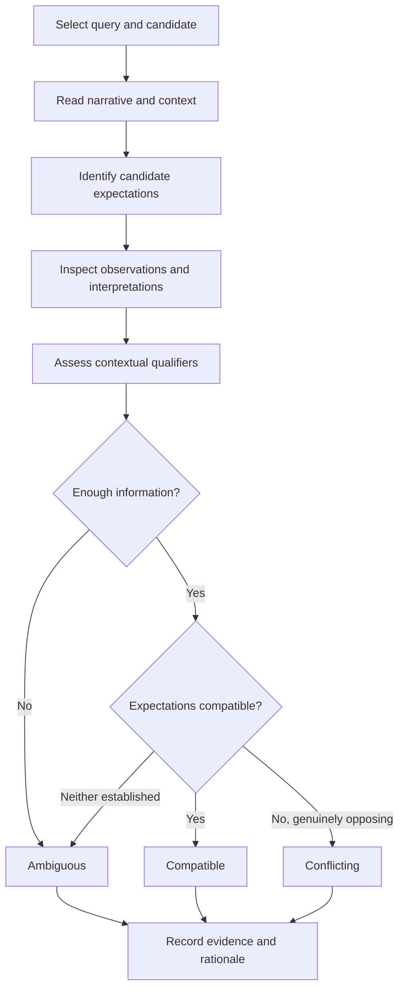

# US-007 Review — Expectation-Level Evaluation Specification

## 1. Purpose

This document specifies a future evaluation dataset for identifying and comparing underlying social expectations.

The objective is to evaluate whether the system distinguishes:

- Compatible social expectations.
- Conflicting social expectations.
- Ambiguous or insufficiently supported expectations.

This evaluation complements the existing retrieval benchmark without replacing or modifying it.

The implementation of expectation-level reasoning and its evaluation is deferred to US-028 and US-031.

## 2. Existing Retrieval Benchmark

The existing benchmark consists of:

| Component | Count |
|---|---:|
| Synthetic experiences | 16 |
| Evaluation queries | 12 |
| Query-experience judgments | 192 |
| Uncertain retrieval judgments | 4 |

Existing files:

- `data/synthetic/experiences.json`
- `data/evaluation/queries.json`
- `data/evaluation/relevance_labels.json`

The retrieval benchmark uses the following labels:

| Label | Meaning |
|---|---|
| 2 | Highly relevant |
| 1 | Partially relevant |
| 0 | Not relevant |
| null | Insufficient information |

These labels and the existing benchmark must remain unchanged during the US-007 review.

Expectation-level annotations must be stored separately.

## 3. Evaluation Objectives

The expectation-level benchmark should assess whether a system can:

1. Identify comparable social expectations despite different surface behaviours.
2. Distinguish conflicting expectations despite similar wording.
3. Recognise when contextual qualifiers change the interpretation.
4. Identify evidence supporting a proposed expectation.
5. Recognise insufficient information.
6. Avoid inventing missing context.
7. Distinguish observed behaviour from inferred social meaning.

Retrieval relevance and expectation compatibility are separate evaluation targets.

A highly similar narrative does not necessarily express a compatible expectation.

## 4. Expectation Compatibility Labels

### Compatible

Two expectations are compatible when they express substantially comparable social requirements, permissions, or prohibitions within the available context.

Compatible expectations need not use identical wording or describe identical behaviour.

### Conflicting

Two expectations are conflicting when they prescribe incompatible social requirements, permissions, or prohibitions for a sufficiently comparable situation.

Differences in wording or behaviour alone do not establish conflict.

A contextual difference may explain why apparently opposing expectations are not genuinely conflicting.

### Ambiguous

Compatibility is ambiguous when the available information does not justify a defensible compatible or conflicting classification.

Examples include:

- Missing relationship information.
- Unclear participant roles.
- Uncertain intentions.
- Insufficient behavioural evidence.
- Multiple plausible interpretations.

Ambiguous is not equivalent to irrelevant.

The evaluator must not invent missing information to resolve ambiguity.

## 5. Proposed Annotation Structure

The following is an illustrative annotation record, not an implemented production schema.

```json
{
  "query_id": "Q-001",
  "record_id": "SYN-001",
  "compatibility": "compatible",
  "contextual_qualifiers": [
    {
      "dimension": "relationship",
      "value": "colleagues",
      "relevance": "material"
    },
    {
      "dimension": "setting",
      "value": "workplace social invitation",
      "relevance": "material"
    }
  ],
  "supporting_evidence_ids": ["OBS-001", "INT-001"],
  "missing_context": [],
  "rationale": "The available narrative and contextual information support a comparable expectation concerning explanations for declining invitations.",
  "annotator_id": "annotator-001"
}
```

The evidence references identify material considered during annotation. They do not automatically prove the inferred expectation.

Observation evidence and interpretation evidence must remain distinguishable.

## 6. Annotation Examples

### Example A — Compatible Expectations

**Query:** A colleague appears uncomfortable when an invitation is declined without explanation.

**Candidate:** SYN-001.

**Proposed label:** Compatible.

**Reasoning:** Both concern an expectation that declining a workplace social invitation may require an explanation.

**Relevant qualifiers:** Workplace setting and colleague relationship.

**Evidence:** The colleague asks whether something is wrong after the refusal.

This supports the interpretation but does not establish a universal social rule.

### Example B — Conflicting Expectations

**Query:** Declining a workplace invitation requires an explanation.

**Candidate:** SYN-002, the contrasting example in PAIR-001.

**Proposed label:** Conflicting, provided the candidate's full narrative and context support the opposing expectation.

**Reasoning:** The two examples concern comparable invitation situations but potentially opposing expectations about whether a refusal requires justification.

The final annotation must be confirmed against the candidate's evidence rather than inferred solely from its synthetic comparison label.

### Example C — Ambiguous Expectations

**Query:** Someone avoids eye contact, but the interpersonal relationship and setting are unspecified.

**Candidates:** SYN-007 and SYN-008.

**Proposed label:** Ambiguous where the available query context cannot distinguish the relevant expectations.

**Reasoning:** Eye contact may have different interpersonal meanings depending on context.

The evaluator must not assume intention from behaviour alone.

### Example D — Different Behaviour, Comparable Expectation

**Query:** Refusing food is interpreted as rejecting someone's care.

**Candidate:** An experience involving refusal of a handmade gift.

**Proposed label:** Compatible if the available evidence supports the same underlying expectation.

**Reasoning:** Different surface behaviours may express comparable expectations about acknowledging care.

These examples are annotation illustrations, not completed independently validated judgments.

## 7. Contextual Qualifiers

Annotations should record contextual dimensions that materially influence expectation compatibility.

Potential dimensions include:

- Country.
- Cultural background.
- Interpersonal relationship.
- Social roles.
- Setting.
- Situational circumstances.
- Verbal communication.
- Nonverbal behaviour.
- Prior interactions.

Not every dimension is relevant to every expectation.

A missing contextual attribute must not be treated as evidence that the attribute is irrelevant.

Country must not be used as an automatic proxy for a social expectation.

## 8. Evidence Support

Each expectation annotation should distinguish:

1. Directly observed or reported behaviour.
2. Contributor interpretations.
3. AI-generated inferences.
4. Missing or contradictory evidence.

Supporting evidence identifiers should resolve to evidence associated with the candidate experience.

Where an annotation relies on the query text rather than candidate evidence, that distinction must be explicit.

Future evaluation may separately score:

- Expectation compatibility.
- Evidence-reference correctness.
- Evidence sufficiency.
- Recognition of unsupported claims.

A correct compatibility label with fabricated evidence references should not receive full evidence-grounding credit.

## 9. Missing Context and Uncertainty

Missing context must be recorded explicitly when it materially affects interpretation.

For example:

```json
{
  "compatibility": "ambiguous",
  "missing_context": [
    "relationship",
    "setting"
  ],
  "supporting_evidence_ids": [],
  "rationale": "The available information does not distinguish between multiple plausible interpretations."
}
```

An empty evidence-reference list does not necessarily mean that no evidence exists.

It may mean that no specific evidence has been identified as supporting the annotation.

Future validation should distinguish these cases when required.

## 10. Annotation Procedure



Annotators must not use model-generated predictions as ground truth.

The existing synthetic `expectation_label` fields may assist dataset development but must not replace independent evidence-based annotation.

## 11. Annotation Disagreement Handling

The future annotation process should include:

1. A written rubric distributed before annotation.
2. Independent annotations by at least two annotators where feasible.
3. Preservation of initial labels and rationales.
4. Identification of disagreements.
5. Adjudication using available evidence and contextual qualifiers.
6. Documentation of the final adjudicated label.
7. Reporting of agreement statistics when sample size permits.

Disagreement should not automatically be resolved through majority vote.

Where the evidence remains insufficient, the adjudicated label should remain ambiguous.

Agreement statistics must not be reported until independent annotation has actually occurred.

## 12. Held-Out Evaluation Split

The existing retrieval benchmark must remain unchanged.

The expectation-level benchmark should define separate development and held-out evaluation partitions.

### Split unit

Use `pair_id` or a broader scenario-family identifier rather than randomly splitting individual query-candidate judgments.

This reduces leakage from closely related synthetic examples appearing in both partitions.

### Proposed procedure

1. Group related experiences by scenario family.
2. Associate queries with the scenario families they reference.
3. Allocate entire scenario families to development or held-out evaluation.
4. Prevent paraphrases and near-duplicate scenarios from crossing partitions.
5. Record split assignments in a version-controlled manifest.
6. Freeze the held-out labels before final evaluation.
7. Avoid using held-out results to tune prompts, thresholds, or ranking configurations.

A candidate scenario may appear in multiple query judgments, so splitting individual judgments independently is not acceptable.

### Limitation

With only 16 synthetic experiences, the existing dataset is too small to support strong generalisation claims.

A larger and independently annotated expectation-level dataset may be necessary for meaningful held-out evaluation.

The exact split and proportions should be selected when the expectation-level dataset is constructed.

## 13. Evaluation Metrics

Potential future metrics include:

| Metric | Evaluation target |
|---|---|
| Macro-F1 | Compatibility classification across labels |
| Per-class precision and recall | Compatible, conflicting, ambiguous predictions |
| Confusion matrix | Types of expectation-classification errors |
| Evidence precision/recall | Correctness of cited supporting evidence |
| Ambiguity recognition rate | Identification of insufficiently supported cases |
| Performance by scenario family | Robustness across expectation types |

Metrics should be selected before final held-out evaluation.

The evaluation must report class frequencies and limitations.

These metrics are distinct from retrieval Recall@K and MRR.

## 14. Relationship to US-028 and US-031

### US-028

The proposed expectation annotations should inform the relevant M9 expectation-reasoning functionality.

The future implementation should specify its exact input and output contracts before this annotation schema is finalized.

### US-031

The expectation-level benchmark should support evaluation of the relevant M9 capabilities.

The future evaluation work should operationalise compatibility labels, evidence correctness, ambiguity handling, and held-out testing.

The precise division of implementation responsibilities must be checked against the final US-028 and US-031 issue descriptions.

This review does not implement either issue.

## 15. Scientific Limitations

The current data is synthetic and manually constructed.

It is suitable for:

- Early-stage development.
- Controlled contrastive examples.
- Regression testing.
- Detecting obvious expectation-matching failures.

It is not sufficient for:

- Estimating the prevalence of social expectations.
- Making representative claims about countries or cultures.
- Establishing universal interpersonal rules.
- Demonstrating generalisation to real-world experiences.

Synthetic expectation labels are design assumptions, not population evidence.

## 16. Review Decision

The existing retrieval benchmark should be retained without modification.

A separate expectation-level annotation dataset should be introduced during the relevant M9 work.

The proposed dataset should include:

- Compatible, conflicting, and ambiguous labels.
- Contextual qualifiers.
- Evidence references.
- Missing-context annotations.
- Annotation rationales and provenance.
- Disagreement resolution.
- A leakage-controlled held-out split.

**No production retrieval or evaluation code changes are required by this review.**