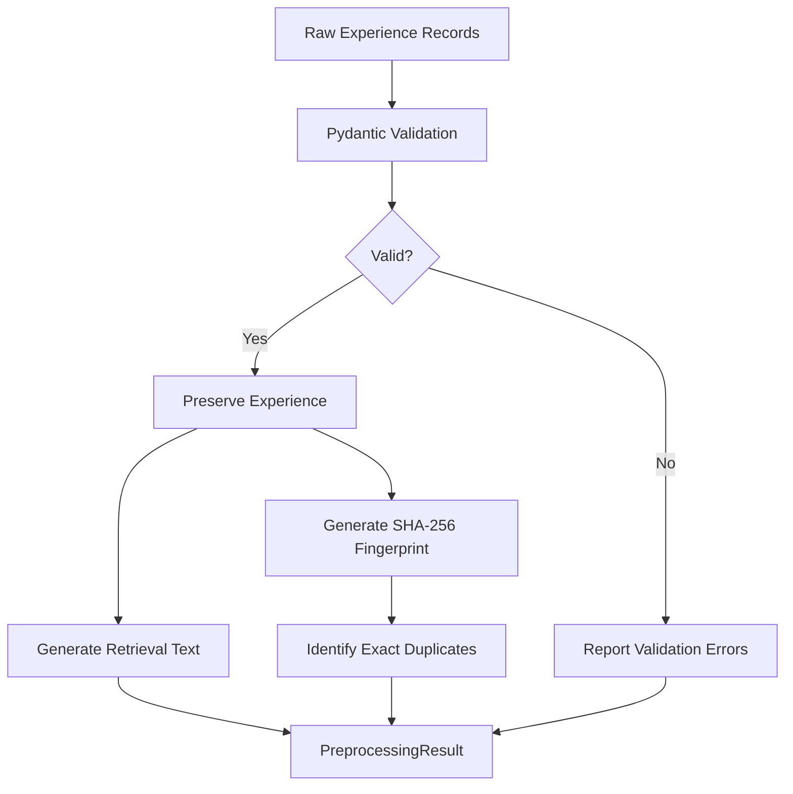
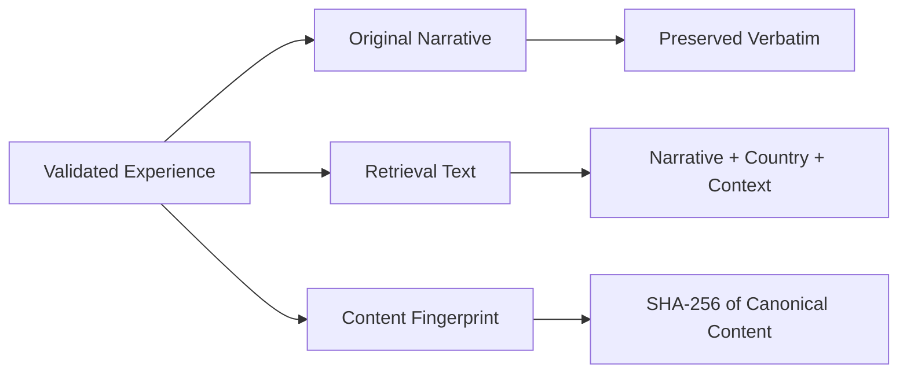
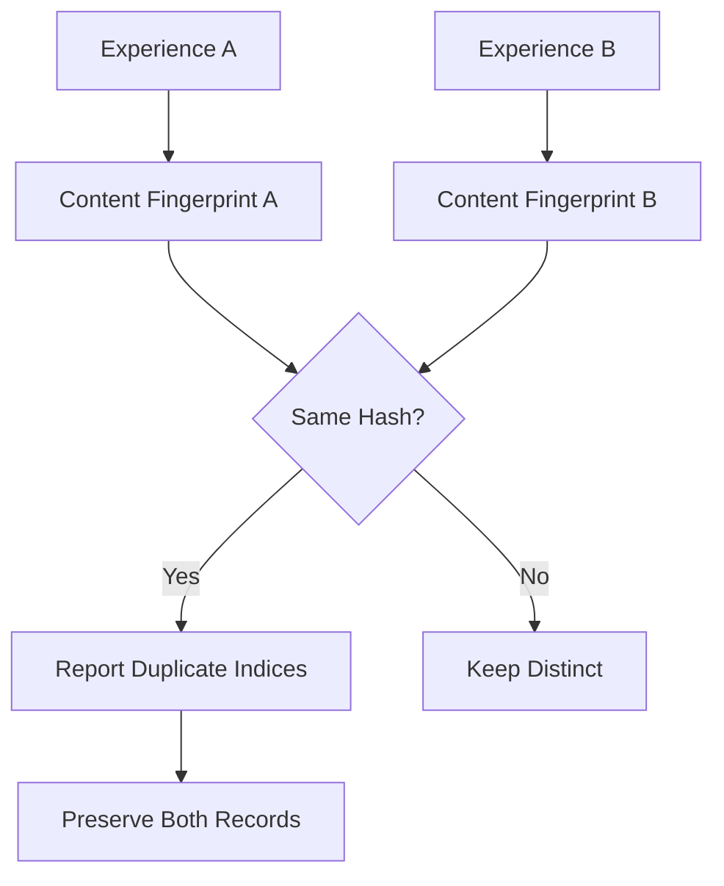
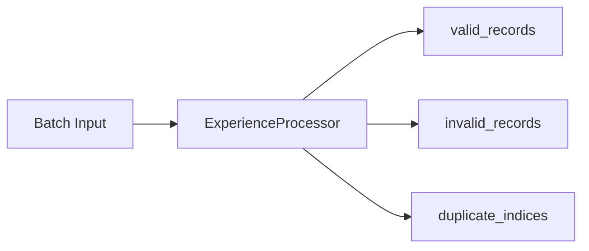

# Experience Preprocessing

## 1. Overview

The preprocessing pipeline validates experience records and prepares them for retrieval without rewriting or interpreting the original narrative.



## 2. Input Schema

Validation uses the existing `Experience` Pydantic domain model.

| Required | Optional |
|---|---|
| `narrative` | `context` |
| `country` | `evidence` |

The model also manages record identifiers, timestamps, and moderation status.

**Principle:** Missing contextual information is not equivalent to irrelevant contextual information.

## 3. Data Transformation

A valid experience produces three distinct outputs.



### Example

**Input narrative:**

> "  A colleague ignored my greeting.  "

**Derived retrieval text:**

```text
Narrative:   A colleague ignored my greeting.  
Country: Egypt
```

The original narrative, including whitespace, remains unchanged.

Contextual attributes are included in deterministic key order. Unknown attributes are explicitly represented as unknown.

Evidence is retained in the validated experience but excluded from the initial retrieval text.

## 4. Duplicate Identification

Each valid record receives a SHA-256 fingerprint derived from canonical JSON.

| Included in fingerprint | Excluded |
|---|---|
| Narrative | Generated UUID |
| Country | Timestamps |
| Context | Moderation status |
| Evidence | |



Duplicate detection is **exact-content based**, not semantic.

Similar experiences expressed differently are not automatically considered duplicates.

## 5. Validation and Error Handling



Invalid records are reported with:

- Original batch index
- Structured Pydantic validation errors

The processor does not silently repair invalid input, discard valid duplicates, or alter narrative meaning.

## 6. Determinism

| Property | Guarantee |
|---|---|
| Original narrative | Preserved exactly |
| Retrieval text | Deterministic for equivalent validated content |
| Content fingerprint | Deterministic for equivalent canonical content |
| Context ordering | Sorted by attribute name |
| Generated metadata | May vary between runs |
| Duplicate handling | Identifies duplicates without deleting them |

## 7. Scope and Limitations

### Implemented

- Pydantic validation
- Original narrative preservation
- Derived retrieval text
- SHA-256 content fingerprints
- Exact-content duplicate identification
- Structured validation error reporting

### Not Yet Implemented

- Semantic duplicate detection
- Embedding generation
- Vector indexing
- Database persistence
- Moderation decisions
- Retrieval evaluation

These responsibilities belong to subsequent pipeline stages.