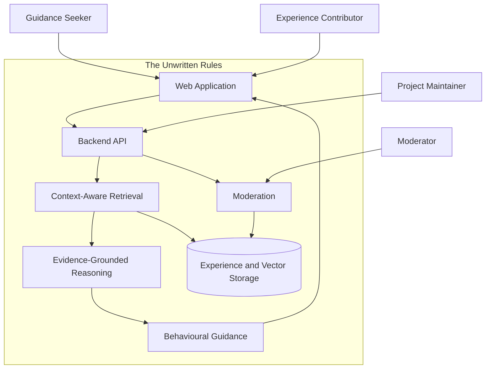
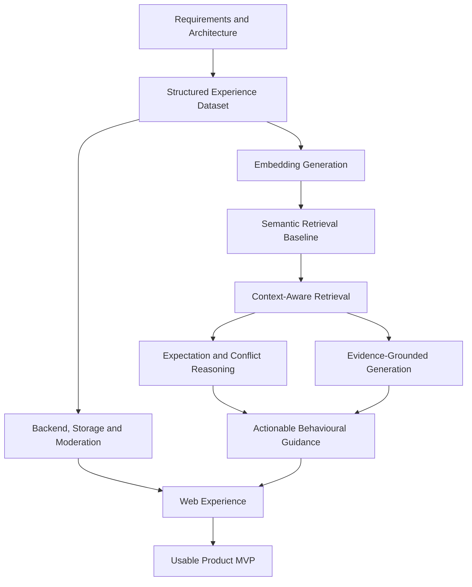
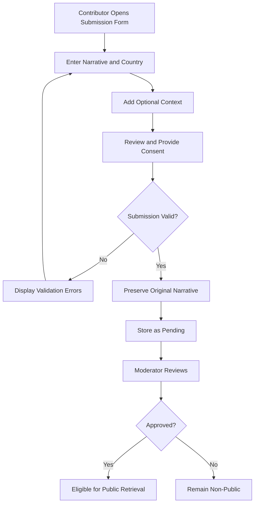
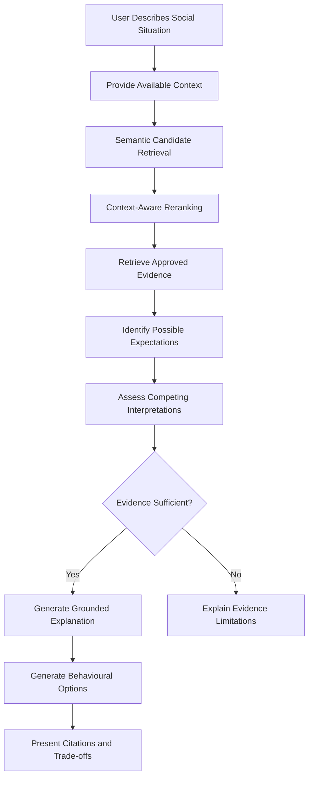
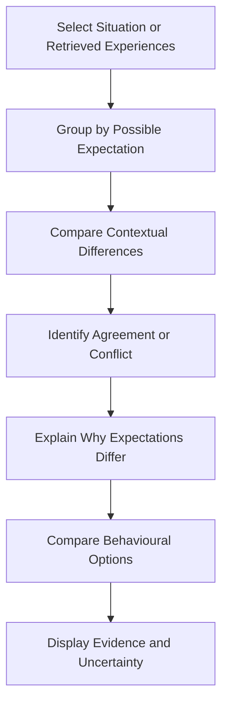
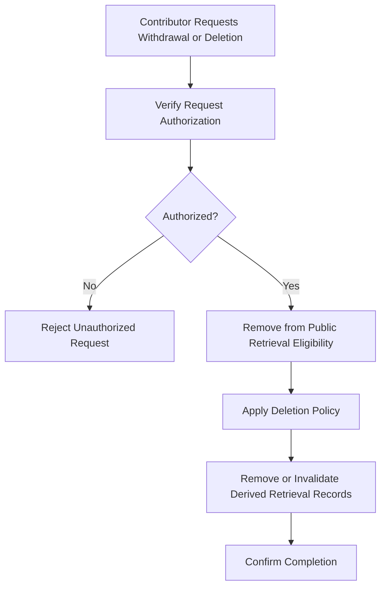

# The Unwritten Rules — Product Requirements

**User Story:** US-002 — Define MVP Scope and Functional Requirements  
**Status:** Requirements baseline  
**Last updated:** October 2026

---

## 1. Product Vision

### 1.1 Purpose

The Unwritten Rules is a context-aware, evidence-grounded Retrieval-Augmented Generation (RAG) application that helps people understand implicit social expectations and make informed decisions about how to respond to social situations.

The application retrieves relevant first-person experiences, examines their contextual differences, identifies possible and conflicting social expectations, and provides actionable behavioural guidance.

Its purpose is not simply to explain social norms. It must help users understand **what they could actually say or do, why, and with what potential trade-offs**.

### 1.2 Problem Statement

Social expectations are frequently implicit, context-dependent and inconsistent.

Two experiences may be semantically similar while involving different expectations. Conversely, experiences described differently may express the same underlying social expectation.

General-purpose AI systems can offer social advice, but their responses do not necessarily rely on a structured, inspectable collection of human-reported experiences.

The Unwritten Rules addresses this through contextual retrieval, evidence traceability, competing interpretations and practical guidance.

### 1.3 Product Differentiation

The application's distinguishing capabilities are:

1. **Context-aware retrieval:** Evaluate cultural, interpersonal, situational, verbal and nonverbal context rather than semantic similarity alone.
2. **Expectation-level reasoning:** Identify underlying expectations instead of treating similar wording as equivalent social rules.
3. **Conflicting expectations:** Represent incompatible interpretations without assuming that one expectation is universally correct.
4. **Actionable behavioural guidance:** Suggest concrete responses, alternatives, boundaries and trade-offs.
5. **Evidence grounding:** Connect interpretations to moderated first-person experiences and distinguish evidence from inference.
6. **Empirical evaluation:** Measure whether contextual retrieval and grounded guidance improve upon simpler retrieval methods and general-purpose AI baselines.

These capabilities define the product's direction and must inform architectural decisions from the beginning.

### 1.4 Product Principles

- Contextual relevance is not equivalent to semantic similarity.
- Social expectations are not universal or necessarily justified.
- Missing context must not be interpreted as irrelevant context.
- Multiple interpretations may remain plausible.
- Contributors' original narratives must be preserved.
- Human-reported experiences are not proof of population-wide norms.
- Generated interpretations must be distinguishable from source evidence.
- Behavioural guidance must preserve user autonomy.
- Personal boundaries must not automatically be subordinated to social expectations.
- Uncertainty must be communicated explicitly.
- Unapproved experiences must not be publicly retrievable.
- The architecture must follow SOLID principles and remain maintainable, testable and extensible.

---

## 2. System Context

The system serves users seeking guidance, experience contributors, moderators and project maintainers.

This diagram represents the intended logical architecture, not a claim that every component has already been implemented.

---

## 3. User Personas and Use Cases

### P1 — Guidance Seeker

A person who has experienced an unfamiliar, ambiguous, uncomfortable or culturally unfamiliar social situation.

**Primary use cases:**
- Describe a situation.
- Supply relevant contextual information.
- Discover similar or contextually relevant experiences.
- Understand possible implicit expectations.
- Compare competing interpretations.
- Receive practical behavioural options.
- Inspect supporting evidence and uncertainty.

### P2 — Experience Contributor

A person who wishes to document a social experience that may help others.

**Primary use cases:**
- Submit an original narrative.
- Specify the country.
- Provide optional contextual information.
- Review and consent to the intended use of their contribution.
- Request deletion of their contribution.
- Optionally report actions taken and subsequent outcomes.

### P3 — Moderator

A person responsible for reviewing submitted experiences.

**Primary use cases:**
- Review pending submissions.
- Identify privacy and safety concerns.
- Approve or reject publication.
- Remove inappropriate or sensitive content.
- Ensure unapproved material is excluded from public retrieval.

### P4 — Project Maintainer

A developer responsible for the application's reliability and evolution.

**Primary use cases:**
- Maintain the data and retrieval pipelines.
- Evaluate retrieval and generation quality.
- Run automated tests.
- Manage deployment and monitoring.
- Extend components without tightly coupling the architecture.

---

## 4. Functional Requirements

### FR-001 — Experience Submission

The system must allow contributors to submit experiences containing:

**Required:**
- Original narrative.
- Country.

**Optional:**
- Cultural context.
- Interpersonal context.
- Situational context.
- Verbal context.
- Nonverbal context.

The submission must be validated before storage.

**Related issues:** US-001, US-003, US-017, US-022

### FR-002 — Narrative Preservation

The system must preserve the original submitted narrative without AI rewriting.

Any normalized or derived retrieval representation must remain separate from the original narrative.

**Related issues:** US-003, US-006

### FR-003 — Consent and Publication Control

The system must explain how submitted experiences may be stored, moderated, retrieved and displayed.

Contributors must provide explicit consent before submission.

Consent must be recorded, and the system must support withdrawal through the applicable deletion or unpublishing workflow.

Unapproved experiences must remain inaccessible to public retrieval.

**Related issues:** US-019, US-020, US-022

### FR-004 — Moderation

Every new experience must initially have a non-public moderation status.

Only approved experiences may become eligible for public retrieval.

Moderation decisions must be enforced by the retrieval and persistence layers.

**Related issues:** US-019, US-021

### FR-005 — Semantic Retrieval

Users must be able to retrieve experiences relevant to a natural-language description of a social situation.

The initial retrieval baseline must use semantic embeddings and similarity search.

**Related issues:** US-008, US-009, US-018, US-023

### FR-006 — Context-Aware Retrieval

The system must consider available contextual information when ranking retrieved experiences.

Contextual compatibility must be evaluated independently of semantic similarity.

Missing contextual information must not automatically be interpreted as evidence of incompatibility.

**Related issues:** US-011, US-012, US-013

### FR-007 — Social Expectation Identification

The system must identify possible implicit expectations supported by retrieved experiences.

It must distinguish the underlying expectation from the narrative wording used to describe an experience.

Interpretations must remain linked to their supporting evidence.

**Related issues:** US-014, US-028

### FR-008 — Conflicting Expectations

The system must identify and present potentially incompatible social expectations.

Where evidence supports multiple interpretations, the system must not force a single universal conclusion.

It must explain relevant contextual differences and uncertainty.

**Related issues:** US-012, US-028

### FR-009 — Evidence-Grounded Explanation

The system must generate explanations grounded in retrieved, approved experiences.

Generated explanations must:
- Reference supporting evidence.
- Distinguish observations from interpretations.
- Avoid inventing source experiences.
- Acknowledge insufficient or contradictory evidence.

**Related issues:** US-014, US-015, US-016

### FR-010 — Actionable Behavioural Guidance

The system must provide practical options for responding to a social situation.

Where appropriate, guidance must include:
- Concrete actions.
- Example language.
- Alternative responses.
- Contextual considerations.
- Potential trade-offs.
- Personal boundaries.
- Explicit uncertainty.

Recommendations must not be presented as guaranteed outcomes or universally correct behaviour.

**Related issues:** US-029

### FR-011 — Contextual Comparison

Users must be able to compare retrieved experiences and possible social expectations across relevant contexts.

Comparisons must highlight similarities, differences and potentially conflicting expectations.

**Related issues:** US-024, US-028

### FR-012 — Privacy and Deletion

Contributors must have an applicable mechanism to request deletion or withdrawal of their submitted experiences.

Deletion and unpublishing must prevent withdrawn experiences from continuing to appear in public retrieval.

The system must define how derived records, embeddings and retained backups are handled.

**Related issues:** US-020

### FR-013 — Reported Actions and Outcomes

The system should support optional contributor-reported actions and outcomes.

These must be distinguished from generated recommendations and predictions.

Reported outcomes must not be treated as proof that an action caused a particular result.

**Related issues:** US-030

### FR-014 — Reproducible Evaluation

The system must support evaluation of:
- Semantic retrieval.
- Context-aware retrieval.
- Expectation identification.
- Conflict recognition.
- Evidence faithfulness.
- Behavioural guidance quality.
- Comparative product value.

**Related issues:** US-007, US-010, US-013, US-016, US-031

---

## 5. Non-Functional Requirements

| ID | Category | Requirement |
|---|---|---|
| NFR-001 | Maintainability | Follow SOLID principles, modular boundaries and dependency inversion. |
| NFR-002 | Testability | Core logic must be independently testable using automated unit and integration tests. |
| NFR-003 | Extensibility | Support additional models, context attributes, mobile clients and media types without major redesign. |
| NFR-004 | Privacy | Protect personal information, enforce moderation and support deletion or withdrawal. |
| NFR-005 | Security | Validate inputs, enforce authorization and protect secrets and stored data. |
| NFR-006 | Reliability | Handle missing context, invalid input, unavailable services and insufficient evidence gracefully. |
| NFR-007 | Reproducibility | Version datasets, configurations, evaluation labels and model choices. |
| NFR-008 | Performance | Measure retrieval and generation latency against documented workloads and deployment resources. |
| NFR-009 | Observability | Record operational errors and relevant system metrics without unnecessarily exposing personal narratives. |
| NFR-010 | Deployability | Support reproducible container builds, automated testing and documented deployment. |
| NFR-011 | Evidence Integrity | Never fabricate citations, source experiences or reported outcomes. |
| NFR-012 | Cost Awareness | Prefer infrastructure appropriate to a small application and avoid unnecessary operational complexity. |

### 5.1 Performance Targets

Numerical performance targets must be established after baseline measurements on the intended deployment environment.

Measurements should include:
- Retrieval latency.
- End-to-end response latency.
- Embedding throughput.
- Database query performance.
- Resource consumption.
- Error rates.

Targets must be measurable rather than arbitrary.

### 5.2 Engineering Standards

The implementation must:
- Separate domain, application and infrastructure concerns.
- Use explicit interfaces for replaceable dependencies.
- Avoid embedding business logic directly into API routes.
- Keep model-specific logic isolated behind adapters.
- Use automated tests and CI.
- Preserve a reproducible semantic retrieval baseline.
- Avoid premature microservice decomposition.

**Related issues:** US-004, US-026, US-027

---

## 6. MVP Scope and Boundaries

### 6.1 MVP Definition

The MVP is the smallest usable version that delivers the application's distinctive value.

A conventional semantic search or RAG demonstration is an intermediate engineering milestone, not the completed product MVP.

### 6.2 Required MVP Capabilities

| Capability | MVP |
|---|---|
| Text-based experience submission | Required |
| Narrative and country validation | Required |
| Optional contextual fields | Required |
| Original narrative preservation | Required |
| Contributor consent | Required |
| Moderation before publication | Required |
| Persistent experience storage | Required |
| Semantic retrieval | Required |
| Context-aware retrieval | Required |
| Evidence-grounded explanations | Required |
| Source traceability | Required |
| Conflicting expectation recognition | Required |
| Actionable behavioural guidance | Required |
| Contextual comparison | Required |
| Uncertainty handling | Required |
| Privacy and deletion controls | Required |
| Responsive web interface | Required |
| Automated testing and evaluation | Required |

### 6.3 Post-MVP Enhancements

- Native iOS and Android applications.
- Image and audio submissions.
- Media-specific processing.
- Contributor-reported actions and outcomes.
- More advanced social expectation discovery.
- Expanded comparisons against general-purpose AI.
- Advanced personalization.
- Additional infrastructure and orchestration.

These enhancements must not compromise the maintainability or extensibility of the MVP architecture.

### 6.4 Infrastructure Boundaries

The application will be designed for containerisation, automated testing and cloud deployment.

Docker, GitHub Actions and cloud deployment form part of the engineering roadmap.

Kubernetes deployment using a local cluster such as `kind` is an additional DevOps deliverable, not a dependency of the first usable product.

The application must remain deployable without Kubernetes.

---

## 7. MVP Capability Dependencies

The implementation sequence and the MVP feature set are different concepts.

Some capabilities are implemented later because they depend on earlier infrastructure, even though they are essential to the final MVP.

**Important:** M9 contains capabilities essential to the MVP, particularly conflicting-expectation recognition and actionable guidance. Their milestone number does not make them optional.

---

## 8. User Journeys

### 8.1 Experience Submission and Moderation

**Success condition:** A validated submission is stored with its original narrative and cannot become publicly retrievable without approval.

### 8.2 Discovery, Interpretation and Guidance

**Success condition:** A user receives relevant evidence, possible interpretations and practical response options, or a clear explanation of why the evidence is insufficient.

### 8.3 Contextual Comparison

**Success condition:** Users can understand how the same or similar social situation may carry different expectations across contexts.

### 8.4 Consent Withdrawal and Deletion

**Success condition:** Withdrawn experiences no longer appear in public retrieval, and deletion is handled according to a documented retention policy.

---

## 9. Evaluation Requirements

The evaluation strategy must test the application's individual capabilities and its overall product value.

| Component | Evaluation Focus | Related Issues |
|---|---|---|
| Semantic retrieval | Recall@K, MRR | US-007, US-010 |
| Context-aware retrieval | Contextual relevance and ranking improvements | US-011, US-013 |
| Expectation identification | Correctness and evidence support | US-028 |
| Conflict recognition | Identification of incompatible expectations | US-028 |
| Grounded generation | Faithfulness and citation accuracy | US-014, US-016 |
| Behavioural guidance | Actionability, contextual appropriateness and uncertainty | US-029, US-031 |
| Product differentiation | Comparison with general-purpose AI | US-031 |

### 9.1 Evaluation Principles

- Preserve the semantic retrieval baseline for comparison.
- Evaluate contextual retrieval independently of generation.
- Separate rule identification from behavioural guidance evaluation.
- Use human-reviewed examples where feasible.
- Document uncertainty and limitations.
- Do not interpret synthetic examples as empirical evidence of social prevalence.
- Avoid using the same examples to both construct and independently evaluate a system without acknowledging the resulting bias.

### 9.2 Comparative Evaluation

The application should eventually be compared against a general-purpose LLM responding to equivalent social situations.

Comparisons should consider:
- Contextual relevance.
- Recognition of competing expectations.
- Evidence traceability.
- Practical usefulness.
- Respect for personal boundaries.
- Uncertainty calibration.

The objective is to establish whether the application's structured evidence and retrieval pipeline provide demonstrable value beyond generic AI advice.

---

## 10. Requirements Traceability

| Milestone | Scope | Related Issues |
|---|---|---|
| M1 | Requirements, data modelling and architecture | US-001–US-004 |
| M2 | Dataset construction and evaluation labels | US-005–US-007 |
| M3 | Embeddings and semantic retrieval | US-008–US-010 |
| M4 | Context-aware retrieval and ambiguity | US-011–US-013 |
| M5 | Evidence-grounded generation | US-014–US-016 |
| M6 | Persistence, moderation, privacy and APIs | US-017–US-021 |
| M7 | Web submission, search and comparison | US-022–US-024 |
| M8 | Containerisation, CI/CD and deployment | US-025–US-027, US-038 |
| M9 | Social expectation intelligence and product differentiation | US-028–US-031 |
| M10 | Cross-platform mobile applications | US-032–US-034 |
| M11 | Multimodal experience support | US-035–US-037 |

### 10.1 Compatibility Reviews

The following review sub-issues must be considered before modifying their parent components:

| Review Issue | Component |
|---|---|
| #39 | Experience schema extensibility |
| #40 | Rule-level evaluation dataset |
| #41 | Independent semantic retrieval baseline |
| #42 | Contextual reranking compatibility |
| #43 | Conflicting expectations and uncertainty |
| #44 | Competing interpretations and evidence provenance |
| #45 | Evaluation coverage and separation from M9 |

These reviews are intended to prevent incompatible assumptions and unnecessary reimplementation.

---

## 11. Definition of MVP Completion

The MVP is complete when a user can:

1. Describe a social situation and provide relevant context.
2. Retrieve approved, contextually relevant experiences.
3. Understand plausible implicit social expectations.
4. Recognize conflicting expectations where supported.
5. Compare relevant contexts and interpretations.
6. Receive practical behavioural options and example responses.
7. Inspect evidence, uncertainty and potential trade-offs.

Additionally:

- Contributors can submit experiences with informed consent.
- Original narratives are preserved.
- Moderation prevents unapproved public retrieval.
- Privacy and deletion controls function correctly.
- Core workflows are covered by automated tests.
- Retrieval and generation quality are evaluated.
- The web application is usable and deployable.

**A working semantic search pipeline alone does not satisfy the MVP definition.**

---

## 12. Open Implementation Decisions

The following decisions must be resolved before implementing their dependent components:

1. **Contributor identity:** How contributors can later authenticate deletion or withdrawal requests without requiring unnecessary personal data.
2. **Consent records:** How consent version, timestamp and scope are stored.
3. **Retention policy:** How deleted submissions, embeddings, logs and backups are handled.
4. **Expectation representation:** Whether expectations are stored as explicit annotations, derived dynamically or represented through a hybrid approach.
5. **Evaluation thresholds:** Which measured results constitute acceptable MVP quality.
6. **Deployment targets:** Which low-cost cloud services will host the application.

These decisions do not prevent continued work on the independent embedding-generation component in US-008.

They must, however, be resolved before implementing functionality that depends on them.