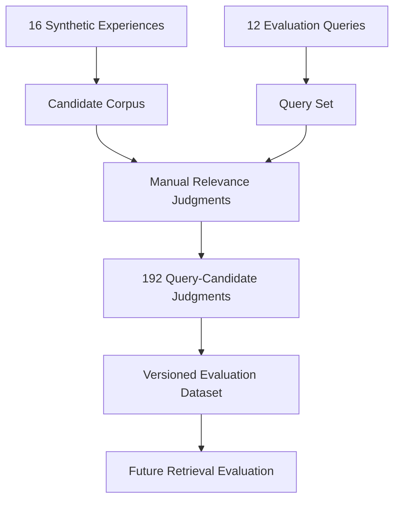
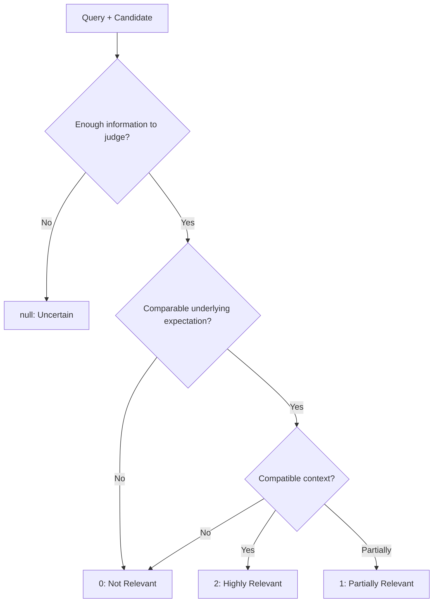
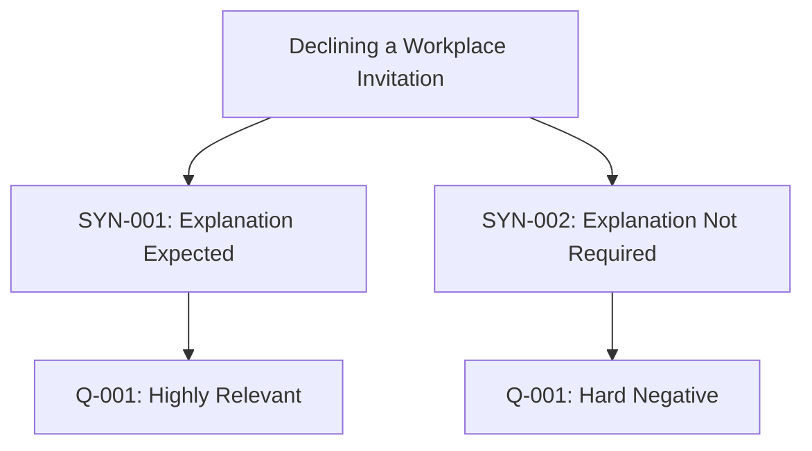
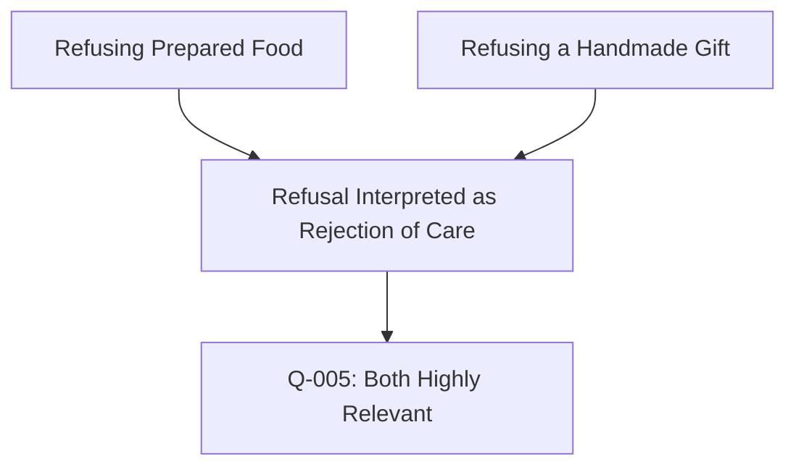
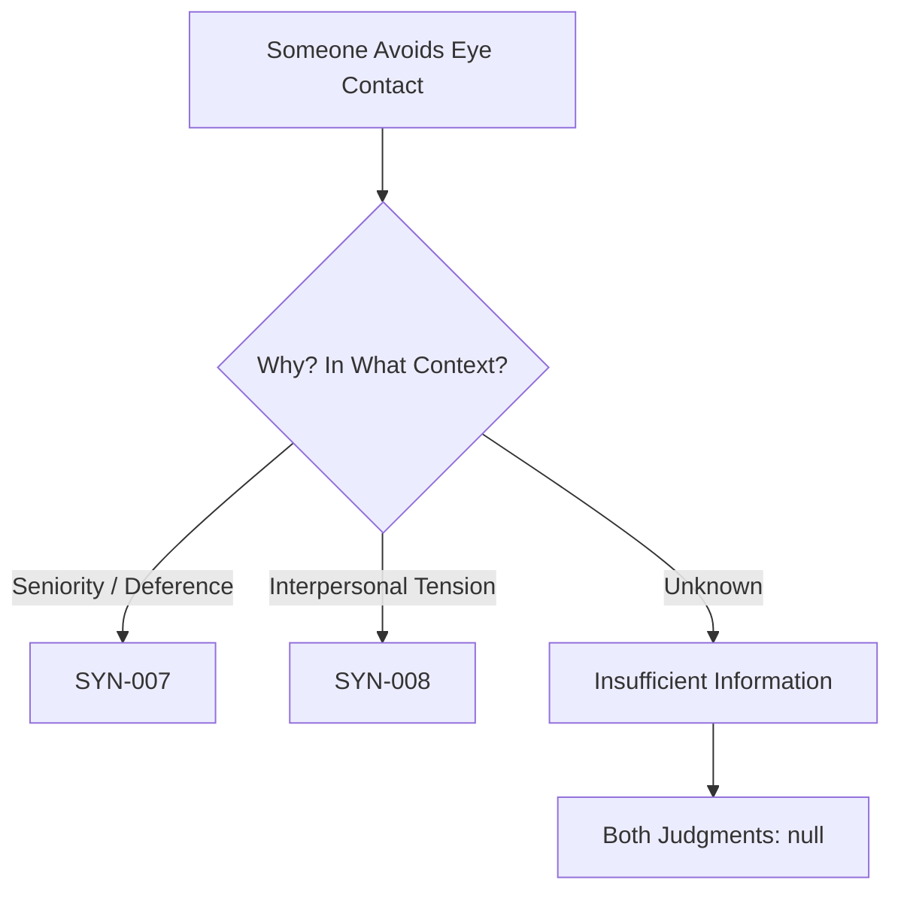
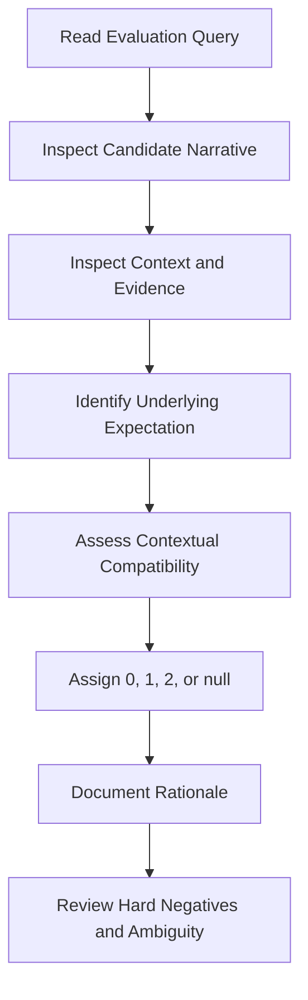
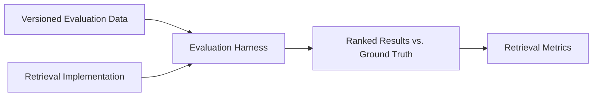

# Retrieval Evaluation Methodology

## 1. Purpose

Evaluate whether retrieval identifies experiences governed by **comparable underlying social expectations**, rather than merely matching words or behaviours.

The evaluation dataset is independent of the retrieval implementation.

## 2. Dataset Structure

| File | Purpose |
|---|---|
| `data/synthetic/experiences.json` | Candidate experiences |
| `data/evaluation/queries.json` | Evaluation queries and contextual information |
| `data/evaluation/relevance_labels.json` | Manual relevance judgments and rationales |
| `backend/tests/test_evaluation_dataset.py` | Dataset integrity tests |

### Dataset Version

- **Schema version:** `1.0`
- **Queries:** 12
- **Candidate experiences:** 16
- **Total judgments:** 192
- **Uncertain judgments:** 4

The evaluation files are tracked in Git. Changes to queries, candidate experiences, or relevance judgments should be reviewed and committed together when necessary.

The schema version identifies the label-file format; it does not independently version the full benchmark contents. Benchmark revisions should therefore be identifiable through Git commits or tags.

## 3. Relevance Labelling Rubric

| Label | Classification | Criteria |
|---|---|---|
| `2` | Highly relevant | Comparable underlying expectation and compatible context |
| `1` | Partially relevant | Related expectation with meaningful contextual differences |
| `0` | Not relevant | Different underlying expectation or incompatible context |
| `null` | Uncertain | Insufficient information for a defensible judgment |

### Labelling Principles

1. **Expectation over wording:** Similar vocabulary does not establish relevance.
2. **Context matters:** Relationships, settings, and situational details influence compatibility.
3. **Behaviour is not meaning:** The same action can communicate different expectations.
4. **Different behaviours can express the same expectation.**
5. **Missing context is not irrelevant context:** Uncertainty must be represented explicitly.
6. **Country is contextual evidence, not a relevance rule:** Matching countries does not guarantee relevance, and different countries do not automatically imply incompatibility.

Labels are judgments about the available narratives and contexts, not universal claims about the cultures represented.

## 4. Evaluation Query Categories

| Category | Queries | What It Tests |
|---|---|---|
| Similar wording, different expectations | Q-001–Q-004 | Distinguishing social meaning despite behavioural similarity |
| Different wording, same expectation | Q-005–Q-008 | Recognising comparable expectations across different behaviours |
| Context-sensitive | Q-009–Q-010 | Using interpersonal and situational context |
| Ambiguous | Q-011–Q-012 | Recognising insufficient information |

### Similar Behaviour, Different Expectations

The behaviour is similar, but the expectations differ.

### Different Behaviours, Comparable Expectations

The surface behaviours differ, but the underlying expectations are comparable.

## 5. Contextual Compatibility

Contextual compatibility is assessed using available information, including:

| Dimension | Example |
|---|---|
| Relationship | Colleagues, friends, relatives |
| Setting | Workplace, family gathering, private conversation |
| Social roles | Host/guest, junior/senior |
| Interaction | Refusal, silence, eye contact, offering assistance |
| Observed reaction | Acceptance, disappointment, discomfort |
| Interpreted expectation | Justification, deference, reciprocity, care |

These dimensions are not equally relevant to every query.

Context should be evaluated according to its importance for interpreting the specific social expectation.

## 6. Ambiguity and Missing Information

Q-011 and Q-012 deliberately omit information needed to distinguish competing interpretations.

**Policy:**

- Do not invent missing contextual information.
- Do not interpret missing information as evidence of irrelevance.
- Preserve `null` judgments in the dataset.
- Exclude `null` judgments from scored metrics unless a separate evaluation policy explicitly defines how to handle them.

A retrieval evaluation must not silently convert uncertain judgments into negative labels.

## 7. Manual Labelling Procedure

Each query is assessed against all 16 candidate experiences.

The initial labels are manually proposed judgments based on the synthetic corpus. They have not undergone independent multi-annotator validation.

### Review Priorities

- Similar behaviours with opposing expectations
- Cross-behaviour matches
- Borderline partial relevance
- Ambiguous queries
- Potentially misleading cultural assumptions

## 8. Separation from Retrieval Implementation

Retrieval algorithms must not access relevance labels when generating rankings.

Labels are used only by the evaluation harness after retrieval results have been produced.

## 9. Future Metrics

Potential metrics include:

| Metric | Purpose |
|---|---|
| Recall@K | Proportion of relevant candidates retrieved |
| Precision@K | Proportion of retrieved candidates judged relevant |
| nDCG@K | Ranking quality with graded relevance |
| MRR | Rank of the first relevant result |

Before implementing metrics, we must explicitly define:

- Whether relevance `1` counts as relevant for binary metrics
- How `null` judgments are excluded or handled
- Which values of K are evaluated
- How queries without assessable relevant candidates are treated

No retrieval performance results are claimed at this stage.

## 10. Limitations

- Small synthetic corpus of 16 experiences
- Queries constructed from the same designed comparison scenarios
- One initial set of manual relevance judgments
- No independent annotator agreement assessment
- No real-world retrieval validation
- Limited cultural and interpersonal coverage

The dataset is intended for **early-stage retrieval development and regression testing**, not as a representative benchmark of real-world social expectations.