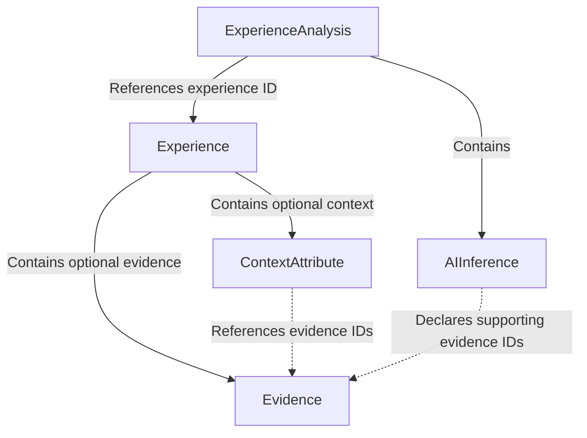

# US-003 Review — Schema Compatibility with M9

## 1. Purpose

This review evaluates whether the existing social experience schema can support future structured social expectations, contextual qualifiers, contributor-reported actions, outcomes, and evidence-grounded reasoning.

The objectives are to:

1. Preserve backward compatibility with existing experience records.
2. Maintain separation between observations, contributor interpretations, and AI-generated inferences.
3. Identify the smallest possible schema extensions.
4. Avoid implementing M9 functionality prematurely.

**Decision:** No immediate production schema changes are required for US-003.

Future extensions should be introduced through optional, independently validated structures.

---

## 2. Existing Domain Architecture

The current domain includes:

| Model | Responsibility |
|---|---|
| `Experience` | Stores original narratives, country, context, evidence, identifiers, timestamps, and moderation status |
| `ContextAttribute` | Represents contributor-supplied contextual information |
| `Evidence` | Distinguishes observations, interpretations, and explicitly unknown evidence types |
| `ExperienceAnalysis` | Associates AI analysis with an existing experience |
| `AIInference` | Stores AI-generated interpretations and supporting evidence references |
| `ModerationStatus` | Represents pending, approved, and rejected states |

### Current relationships



The `AIInference` evidence references are currently stored but are not cross-validated against the corresponding `Experience` by `ExperienceAnalysis`.

That validation is deferred until analysis persistence and evidence resolution are implemented.

---

## 3. Backward Compatibility

An existing experience requires only:

- `narrative`
- `country`

Identifiers, timestamps, and moderation status have defaults.

Context and evidence collections are optional and default to empty collections.

For example:

```json
{
  "narrative": "My friend seemed upset when I declined an invitation.",
  "country": "United Kingdom"
}
```

This record must remain valid after M9 functionality is introduced.

Future structured expectations, actions, outcomes, and contextual interpretations must not become mandatory fields on `Experience`.

### Compatibility requirements

1. Existing records must remain readable.
2. Existing records must not require migration solely to add optional M9 analysis.
3. The original narrative must not be rewritten by AI.
4. Missing context must not be interpreted as irrelevant context.
5. AI-generated conclusions must remain distinguishable from contributor reports.
6. Existing record identifiers must remain stable.

The current schema permits narrative reassignment after model creation. Application-level storage and update operations must therefore enforce original-narrative preservation.

---

## 4. Structured Social Expectations

### Proposed future representation

M9 may introduce a separate `SocialExpectation` structure associated with an experience.

A possible conceptual representation is:

```json
{
  "experience_id": "<existing-experience-uuid>",
  "expectation_id": "expectation-001",
  "description": "Declining an invitation requires an explanation.",
  "qualifiers": {
    "relationship": "close friends",
    "setting": "informal invitation"
  },
  "supporting_evidence_ids": ["e1"],
  "source": "contributor"
}
```

This is an illustrative proposal, not an implemented schema.

### Design considerations

- An experience may support multiple candidate expectations.
- Expectations may be compatible, conflicting, or uncertain.
- Contextual qualifiers should describe when an expectation may apply.
- Expectations must be traceable to their source.
- AI-inferred expectations must not be presented as contributor-reported facts.
- An experience without a structured expectation must remain valid.

### Recommended approach

Initially, store structured expectations separately from the core `Experience` record.

This preserves the existing experience contract and allows future expectation extraction and validation to evolve independently.

---

## 5. Contextual Qualifiers

The existing model already supports extensible context:

```python
context: dict[str, ContextAttribute]
```

Each `ContextAttribute` distinguishes known from explicitly unknown values.

A missing key is different from a key whose status is `unknown`.

### Future considerations

M9 may need richer qualifiers, including:

- Contextual dimension names.
- Contextual values.
- Known, unknown, or insufficiently supported status.
- Source attribution.
- Evidence references.
- Applicability to particular expectations.

The existing context model should remain unchanged until a concrete M9 use case demonstrates that additional fields are necessary.

---

## 6. Contributor-Reported Actions and Outcomes

Actions and outcomes must remain distinct from interpretations of their meaning.

For example:

**Observation:** "I declined the invitation."

**Contributor interpretation:** "I think my friend expected an explanation."

**Reported outcome:** "My friend stopped replying to my messages."

**AI inference:** "The interaction may involve an expectation that refusals should be justified."

These statements have different epistemic statuses and must not be conflated.

### Proposed future representation

```json
{
  "experience_id": "<existing-experience-uuid>",
  "actions": [
    {
      "description": "I declined the invitation.",
      "source": "contributor",
      "evidence_ids": ["e1"]
    }
  ],
  "outcomes": [
    {
      "description": "My friend stopped replying.",
      "source": "contributor",
      "evidence_ids": ["e2"]
    }
  ]
}
```

This is an illustrative future structure, not an implemented model.

### Requirements

- Actions and outcomes are optional.
- They must not be inferred merely because a narrative mentions a possible consequence.
- Reported outcomes must not be treated as proof of causation.
- Contributor-reported information must remain distinguishable from AI-generated interpretations.
- Evidence references should be