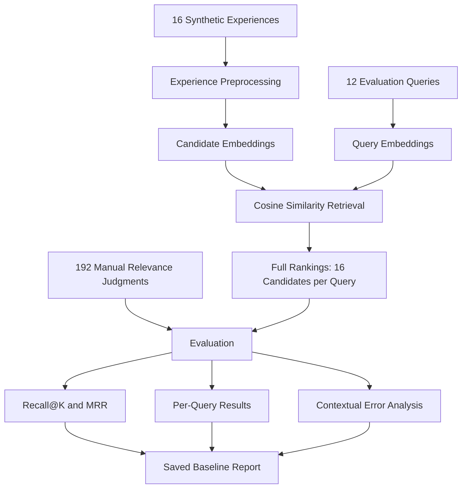
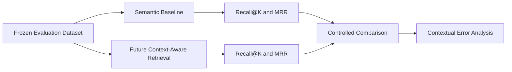

# US-010 — Semantic Retrieval Baseline Evaluation

## 1. Purpose

This report evaluates the semantic retrieval baseline implemented in US-009 against the manually labelled retrieval benchmark developed in US-007.

The objectives are to:

- Measure Recall@K and Mean Reciprocal Rank (MRR).
- Record per-query retrieval performance.
- Identify contextually incorrect matches.
- Establish reproducible baseline results.
- Preserve a reference for future context-aware retrieval comparisons.

This report evaluates retrieval performance, not the accuracy of generated social explanations or behavioural guidance.

## 2. Evaluation Pipeline



The baseline uses the existing semantic search implementation.

The evaluation harness does not modify retrieval rankings.

## 3. Evaluation Dataset

| Component | Count |
|---|---:|
| Synthetic experiences | 16 |
| Evaluation queries | 12 |
| Query-candidate judgments | 192 |
| Uncertain judgments | 4 |
| Queries with at least one highly relevant candidate | 10 |
| Queries without highly relevant candidates | 2 |

Dataset files:

- `data/synthetic/experiences.json`
- `data/evaluation/queries.json`
- `data/evaluation/relevance_labels.json`

The existing relevance judgments remain unchanged.

## 4. Baseline Configuration

| Setting | Value |
|---|---|
| Embedding model | `sentence-transformers/all-MiniLM-L6-v2` |
| Embedding dimensions | 384 |
| Embedding batch size | 32 |
| Retrieval method | In-memory cosine similarity |
| Candidate corpus | 16 synthetic experiences |
| Query set | 12 evaluation queries |
| Retrieval depth | 16 candidates |
| Recall K values | 1, 3, 5, 10 |
| Primary relevant grade | 2 |
| Partial relevance grade | 1, not counted as positive |
| Uncertain grade | `null`, excluded using condensed rankings |
| Unscorable queries | Excluded from aggregate metrics |
| Tie-breaking | Descending similarity, then ascending record ID |

Candidate retrieval text contains:

- Original narrative.
- Country.
- Known and unknown contextual attributes.

Query embeddings use the natural-language `query` field.

The separate structured query `context` field is not independently incorporated into the baseline.

This limitation must be considered when comparing against future context-aware retrieval.

## 5. Metric Definitions

### 5.1 Recall@K

Recall@K measures the proportion of highly relevant candidates retrieved within the first K assessable results.

\[
\operatorname{Recall@K}(q)
=
\frac{|R_q \cap T_{q,K}|}{|R_q|}
\]

Where:

- \(R_q\) is the set of grade-2 candidates for query \(q\).
- \(T_{q,K}\) is the set of the first K candidates in the condensed ranking.

Mean Recall@K is the arithmetic mean across scored queries.

### 5.2 Reciprocal Rank

Reciprocal rank measures the position of the first highly relevant candidate.

\[
RR(q) = \frac{1}{\operatorname{rank}_q}
\]

If no relevant candidate appears in the ranking, the reciprocal rank is zero for an otherwise assessable query.

### 5.3 Mean Reciprocal Rank

\[
MRR =
\frac{1}{|Q_s|}
\sum_{q \in Q_s} RR(q)
\]

Where \(Q_s\) is the set of scored queries.

### 5.4 Uncertainty Policy

Candidates with `null` relevance judgments are removed from the ranking before calculating metrics.

The resulting ranking is called the **condensed ranking**.

This prevents uncertain judgments from being treated as negative examples.

Consequently, metric ranks may differ from the original displayed retrieval positions.

Both rankings are retained in the saved results.

Queries with no grade-2 candidates are marked `unscorable`.

Q-011 and Q-012 are excluded from aggregate Recall@K and MRR, but their retrieval rankings are retained for qualitative analysis.

## 6. Aggregate Results

| Metric | Result |
|---|---:|
| Mean Recall@1 | 0.5500 |
| Mean Recall@3 | 1.0000 |
| Mean Recall@5 | 1.0000 |
| Mean Recall@10 | 1.0000 |
| MRR | 0.8500 |
| Top-1 highly relevant hit rate | 0.7000 |
| Scored queries | 10 |
| Unscorable queries | 2 |

The baseline retrieves all highly relevant candidates within the top three assessable positions for the 10 scored queries.

However, perfect Recall@3 does not imply perfect ranking or correct expectation-level reasoning.

Recall@1 is affected by queries with multiple highly relevant candidates. For those queries, retrieving one relevant candidate at rank 1 produces Recall@1 of 0.5.

The top-1 highly relevant hit rate provides a complementary interpretation: 7 of 10 scored queries place a grade-2 candidate first.

## 7. Per-Query Results

| Query | Status | Top-1 Candidate | Top-1 Grade | First Relevant Rank |
|---|---|---|---:|---:|
| Q-001 | Scored | SYN-002 | 0 | 2 |
| Q-002 | Scored | SYN-003 | 2 | 1 |
| Q-003 | Scored | SYN-006 | 0 | 2 |
| Q-004 | Scored | SYN-007 | 2 | 1 |
| Q-005 | Scored | SYN-009 | 2 | 1 |
| Q-006 | Scored | SYN-011 | 2 | 1 |
| Q-007 | Scored | SYN-001 | 0 | 2 |
| Q-008 | Scored | SYN-016 | 2 | 1 |
| Q-009 | Scored | SYN-002 | 2 | 1 |
| Q-010 | Scored | SYN-004 | 2 | 1 |
| Q-011 | Unscorable | SYN-002 | null | N/A |
| Q-012 | Unscorable | SYN-007 | null | N/A |

Complete per-query rankings, similarity scores, relevance-derived metrics, and evaluation settings are saved in:

`data/evaluation/results/semantic_baseline.json`

## 8. Contextually Incorrect Matches

### 8.1 Q-001 — Invitation Refusal

Query:

> I declined a colleague's dinner invitation without explaining why, and they seemed uncomfortable with my refusal.

| Rank | Candidate | Similarity | Relevance |
|---|---|---:|---:|
| 1 | SYN-002 | 0.8185 | 0 |
| 2 | SYN-001 | 0.6497 | 2 |

The baseline ranks SYN-002 above SYN-001 despite SYN-002 receiving a relevance grade of zero.

The examples involve similar invitation-refusal behaviour but contrasting expectations about whether an explanation is required.

This is a clear example of semantic similarity favouring an incorrect expectation match.

### 8.2 Q-003 — Paying for Lunch

Query:

> I paid for someone's lunch because I considered them my guest, not because I expected anything in return.

| Rank | Candidate | Similarity | Relevance |
|---|---|---:|---:|
| 1 | SYN-006 | 0.6188 | 0 |
| 2 | SYN-005 | 0.5738 | 2 |

The baseline ranks an experience with a different underlying expectation above the relevant experience.

The failure illustrates that similar payment behaviour does not necessarily communicate the same interpersonal expectation.

### 8.3 Q-007 — Workplace Seniority

Query:

> I unintentionally failed to follow a workplace custom that acknowledges someone's higher position.

| Rank | Candidate | Similarity | Relevance |
|---|---|---:|---:|
| 1 | SYN-001 | 0.4097 | 0 |
| 2 | SYN-013 | 0.3938 | 2 |
| 3 | SYN-014 | 0.3296 | 2 |

The baseline ranks a workplace-invitation experience above the experiences concerning acknowledgement of seniority.

This suggests that general workplace-related semantic similarity can outweigh the more specific social expectation.

### 8.4 Cross-Behaviour Matches

Q-005 and Q-006 retrieve highly relevant experiences at ranks 1 and 3.

In both cases, an irrelevant candidate appears between two highly relevant results.

This shows that retrieving all relevant candidates within the top three does not guarantee an ideal ranking.

## 9. Ambiguous Queries

### Q-011

The query describes an invitation refusal without specifying the relationship or the other person's reaction.

The baseline retrieves:

1. SYN-002 — uncertain.
2. SYN-001 — uncertain.

### Q-012

The query describes avoided eye contact without establishing the reason.

The baseline retrieves:

1. SYN-007 — uncertain.
2. SYN-008 — uncertain.

Both queries lack grade-2 candidates and are therefore unscorable under the primary metric policy.

The baseline retrieves potentially pertinent experiences but does not explicitly recognise or communicate uncertainty.

No ambiguity-detection performance claim is made.

## 10. Reproducibility

### Execution

From the `backend/` directory:

```bash
python run_baseline_evaluation.py
```

The command loads the existing evaluation data, generates candidate embeddings, executes all 12 queries, calculates metrics, and writes the baseline results.

### Output

`data/evaluation/results/semantic_baseline.json`

### Repeated-Run Verification

Two consecutive evaluations in the same environment produced identical aggregate metrics and identical output hashes.

SHA-256:

```text
96fac4017fcce39867142c653c29f8521e03313d9b5eb6926ae5e1066cd2cb64
```

This establishes byte-for-byte consistency across the observed local runs.

It does not establish reproducibility across different operating systems, hardware configurations, or dependency versions.

### Additional Reproducibility Requirements

For future cross-environment reproduction, record or pin:

- Python version.
- Sentence Transformers version.
- PyTorch version.
- Embedding model revision.
- Dependency versions.
- Dataset Git revision.
- Evaluation implementation Git revision.

These details have not yet been independently recorded in this report.

## 11. Limitations

1. The corpus contains only 16 synthetic experiences.
2. Queries were constructed around designed comparison scenarios.
3. Relevance judgments have not undergone independent multi-annotator validation.
4. The baseline does not independently use structured query context.
5. Semantic similarity does not guarantee expectation compatibility.
6. The baseline does not explicitly detect ambiguous expectations.
7. Two queries cannot be scored under the primary relevance policy.
8. The current results do not establish generalisation to real-world cultural or interpersonal situations.

Synthetic examples must not be treated as population evidence about countries or cultures.

## 12. Future Comparison with Context-Aware Retrieval

This baseline provides a reference for evaluating later context-aware retrieval methods.

Future comparisons should:

- Use the same frozen evaluation dataset.
- Preserve the same relevance threshold.
- Preserve the same uncertainty policy.
- Report the same K values.
- Compare per-query rankings.
- Analyse changes in contextually incorrect top-ranked matches.
- Avoid tuning against the final held-out evaluation set.



A future model should not be considered better solely because it increases Recall@K on this small synthetic dataset.

Changes in contextual correctness, ranking behaviour, and ambiguity handling must also be examined.

## 13. Conclusion

The semantic retrieval baseline achieves:

- Mean Recall@1 of 0.55.
- Mean Recall@3 of 1.00.
- MRR of 0.85.

These results establish a reproducible initial benchmark on the synthetic evaluation dataset.

The principal observed limitation is that semantically similar experiences can receive higher rankings despite expressing incompatible underlying social expectations.

This motivates future context-aware retrieval and expectation-level evaluation.