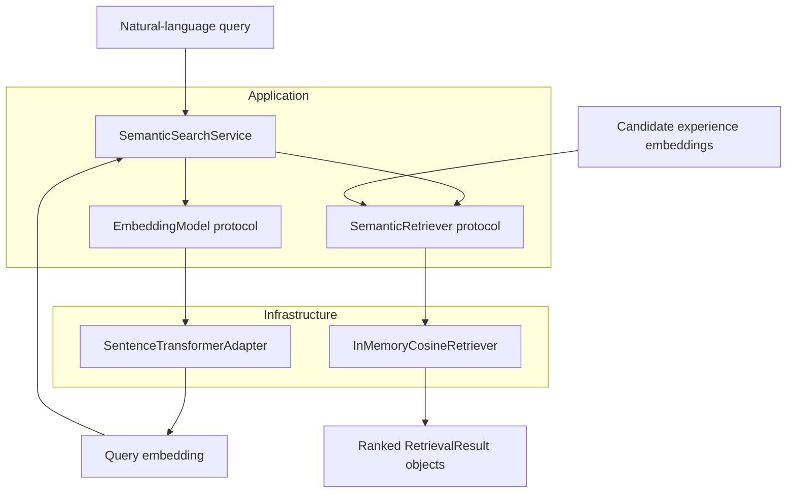
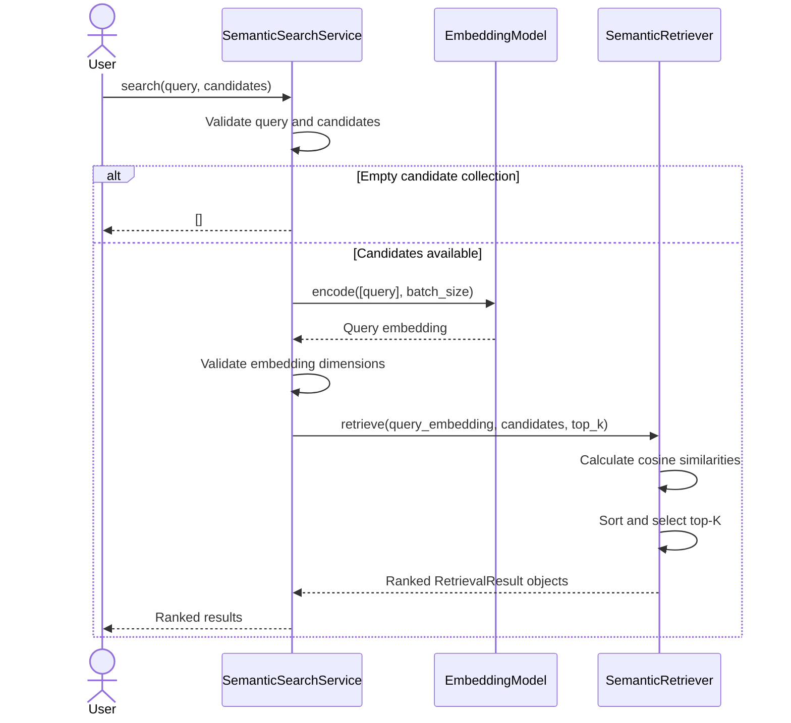
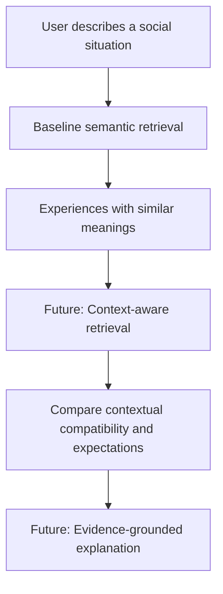

# Baseline Semantic Retrieval

## 1. Purpose

The Unwritten Rules is designed to help people understand implicit social expectations by comparing their experiences with relevant examples.

Before the system can reason about context, conflicting expectations, or possible responses, it needs a way to retrieve experiences related to a user's question.

US-009 implements this first retrieval mechanism: **baseline semantic search**.

Given a natural-language query, the system converts the query into a numerical embedding, compares it against previously generated experience embeddings, and returns the most similar experiences.

This establishes a measurable baseline for later context-aware retrieval.

## 2. Scope

### Implemented

- Natural-language query embedding
- Cosine similarity between embeddings
- Top-K retrieval
- Descending similarity ranking
- Deterministic tie-breaking
- Preservation of original experience identifiers
- Query and embedding validation
- Replaceable embedding and retrieval implementations
- Unit tests and a real-model smoke test

### Not yet implemented

- Context-aware ranking
- Matching experiences by underlying social expectation
- Detection of conflicting social norms
- LLM-generated explanations or behavioural guidance
- Persistent vector storage
- API endpoints or frontend integration
- Quantitative retrieval-quality evaluation

These features belong to subsequent user stories.

## 3. Architecture

The implementation follows a layered architecture.



The application layer coordinates the search without depending directly on Sentence Transformers, a particular similarity implementation, an API, or a database.

Infrastructure adapters implement the interfaces defined by the application layer.

This separation allows the implementation to change without changing the application's search contract.

## 4. Source Code Structure

```text
backend/
├── src/
│   └── unwritten_rules/
│       ├── application/
│       │   ├── embeddings/
│       │   │   ├── interfaces.py
│       │   │   └── models.py
│       │   └── retrieval/
│       │       ├── interfaces.py
│       │       ├── models.py
│       │       └── service.py
│       └── infrastructure/
│           ├── embeddings/
│           │   └── sentence_transformer.py
│           └── retrieval/
│               └── in_memory.py
├── scripts/
│   └── smoke_test_semantic_search.py
└── tests/
    ├── test_cosine_retriever.py
    ├── test_retrieval_models.py
    └── test_semantic_search_service.py
```

## 5. Main Components

### 5.1 EmbeddingModel

`EmbeddingModel` defines the interface for converting text into numerical vectors.

The current infrastructure implementation is `SentenceTransformerAdapter`.

The default model is:

`sentence-transformers/all-MiniLM-L6-v2`

Its embedding dimensionality is 384.

### 5.2 EmbeddedExperience

`EmbeddedExperience` associates a numerical embedding with:

- The original experience identifier
- The embedding model name
- The embedding dimensionality

The identifier allows retrieval results to reference their source experiences.

### 5.3 SemanticRetriever

`SemanticRetriever` defines the contract for ranking candidate embeddings against a query embedding.

Its current implementation is `InMemoryCosineRetriever`.

The interface can later be implemented using a database-backed vector search mechanism.

### 5.4 InMemoryCosineRetriever

This component:

1. Validates the query embedding and requested result count.
2. Checks candidate embedding dimensionality.
3. Computes cosine similarity between the query and each candidate.
4. Sorts candidates by descending similarity.
5. Breaks equal-score ties using experience identifiers.
6. Returns the top-K results.

The implementation does not require a database.

### 5.5 SemanticSearchService

`SemanticSearchService` coordinates the retrieval workflow.

It:

1. Validates the query.
2. Checks candidate compatibility with the configured embedding model.
3. Generates a query embedding.
4. Passes the query embedding and candidate embeddings to the retriever.
5. Returns ranked results.

The service does not implement cosine similarity itself.

## 6. Search Sequence



## 7. Similarity Calculation

Cosine similarity measures the angle between two vectors.

For query embedding `q` and candidate embedding `e`:

\[
\operatorname{cosine}(q,e)
=
\frac{q \cdot e}{\|q\|\|e\|}
\]

The similarity ranges from -1 to 1.

A larger value indicates that the vectors point in more similar directions.

Cosine similarity is a measure of embedding similarity, not proof that two experiences involve the same social expectation.

The implementation rejects zero vectors because their cosine similarity is undefined.

## 8. Retrieval Results

Each result is represented by `RetrievalResult`.

It contains:

| Field | Description |
|---|---|
| `record_id` | Identifier of the original experience |
| `similarity_score` | Cosine similarity between the query and experience embeddings |
| `rank` | Position in the ordered results, starting at 1 |

The service returns at most `top_k` results.

If fewer candidates exist, it returns fewer results.

If the candidate collection is empty, it returns an empty list.

## 9. Validation and Edge Cases

The implementation handles:

- Empty and whitespace-only queries
- Non-string queries
- Invalid top-K values
- Empty candidate collections
- Incompatible embedding model names
- Mismatched embedding dimensions
- Missing query embeddings
- Incorrect query embedding dimensions
- Non-finite embedding values
- Zero vectors
- Similarity ties

These checks help prevent invalid comparisons and unpredictable ranking behaviour.

## 10. Testing

### Unit tests

The retrieval implementation is tested independently of external services.

Relevant test files:

- `test_retrieval_models.py`
- `test_cosine_retriever.py`
- `test_semantic_search_service.py`

The service tests use a fake embedding model to verify orchestration without downloading or executing a real language model.

### Real-model smoke test

The smoke test uses the actual Sentence Transformer adapter and in-memory cosine retriever.

Run it from `backend/`:

```bash
python scripts/smoke_test_semantic_search.py
```

The test uses four sample experiences and the query:

> Why did my friend get upset when I said I couldn't come?

Observed results:

| Rank | Experience ID | Similarity |
|---|---|---|
| 1 | EXP-004 | 0.6975 |
| 2 | EXP-001 | 0.5705 |
| 3 | EXP-003 | 0.2734 |

The two invitation-related experiences ranked above the restaurant-bill example.

This demonstrates that the components can work together using real embeddings.

It does not establish general retrieval quality.

### Full backend test suite

Run:

```bash
python -m pytest tests/ -v
```

At the completion of US-009 implementation testing, all 148 collected backend tests passed.

## 11. Why This Is a Baseline

The Unwritten Rules is concerned with more than whether two experiences describe similar events.

Consider:

**Experience A:** Someone declines an invitation, and their friend accepts the refusal without asking for an explanation.

**Experience B:** Someone declines an invitation, and their friend expects a justification.

These experiences describe similar behaviour but potentially different underlying expectations.

A semantic search system may retrieve both because their language and events are similar.

However, it cannot reliably determine whether their expectations agree, conflict, or depend on different contextual factors.

This distinction motivates the next stage of development.



## 12. Evaluation Plan

The baseline will be evaluated using the project's existing curated dataset:

- 16 synthetic experiences
- 12 evaluation queries
- 192 query-experience relevance judgments

The relevance judgments must not be used to determine retrieval rankings.

They serve as independent evaluation labels.

US-010 will measure how well the semantic baseline retrieves relevant experiences and establish a reference point for future context-aware approaches.

## 13. Design Principles

### Single Responsibility

The embedding adapter generates vectors.

The retriever calculates and ranks similarities.

The search service coordinates the workflow.

### Open/Closed Principle

Alternative retrieval implementations can be added without rewriting the application service.

### Dependency Inversion

The application service depends on `EmbeddingModel` and `SemanticRetriever` protocols rather than concrete infrastructure classes.

### Testability

Fake implementations allow application logic to be tested without real models or external infrastructure.

## 14. Current Limitations

The current implementation:

- Performs an in-memory linear scan of candidate embeddings.
- Requires candidate embeddings to be supplied by the caller.
- Does not persist embeddings.
- Does not filter experiences by moderation status.
- Does not determine whether retrieved experiences share an underlying social expectation.
- Does not use relevance judgments during retrieval.
- Has not yet undergone quantitative retrieval-quality evaluation.

Moderation and publication eligibility must be enforced by the data-selection or access layer before candidate embeddings are supplied to this service.

The current implementation is intentionally small and replaceable so that later features can be added without prematurely introducing infrastructure complexity.

## 15. Next Steps

1. Implement quantitative baseline retrieval evaluation (US-010).
2. Compare semantic retrieval against context-aware approaches.
3. Investigate expectation-level matching and conflicting norms.
4. Introduce persistent vector storage when required.
5. Integrate retrieval with the evidence-grounded RAG pipeline.